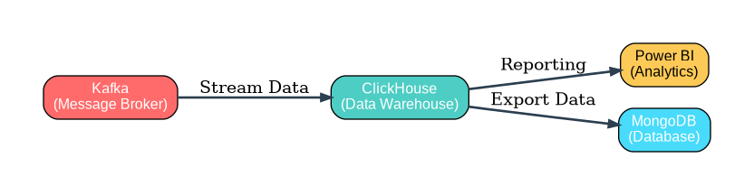

# README.md
---

## 🚀 Installation et Lancement du Projet

Suivez ces étapes pour configurer l environnement de développement sur votre machine.

---

## 📊 Architecture du Pipeline de Données

Le pipeline de données suit l'architecture suivante :
- **Kafka** (Message Broker) → **ClickHouse** (Data Warehouse) : Streaming de données en temps réel
- **ClickHouse** → **Power BI** (Analytics) : Rapports et visualisations
- **ClickHouse** → **MongoDB** (Database) : Export et stockage des données



Pour générer le diagramme d'architecture :
```bash
python generate_pipeline_diagram.py
```

---

### 1. Cloner le dépôt
Commencez par récupérer le projet localement :
```bash
git clone https://github.com/chadia08/bourse-data-pipeline.git

cd bourse-data-pipeline
```
### 2. Créer une branche personnalisée
Il est recommandé de travailler sur une branche séparée portant votre nom :

```
git checkout -b prenom
```

### 3. Configuration de l'environnement virtuel
Créez un environnement Python pour isoler les dépendances du projet :

Sur Windows :

```
python -m venv venv

.\venv\Scripts\activate
```

Sur macOS / Linux :
```
python3 -m venv venv

source venv/bin/activate
```
### 4. Installer les dépendances
Une fois l'environnement activé, installez les bibliothèques nécessaires listées dans le fichier requirements :
```
pip install -r requirements.txt
```
### 5. Lancer l'application avec Docker
Pour démarrer tous les services (base de données, application, etc.) via Docker Compose :
```
docker-compose up --build
```

### 💡 Commandes utiles
Arrêter les conteneurs : ```docker-compose down```

Quitter l'environnement virtuel : ```deactivate```

Vérifier l'état de la branche : ```git status```